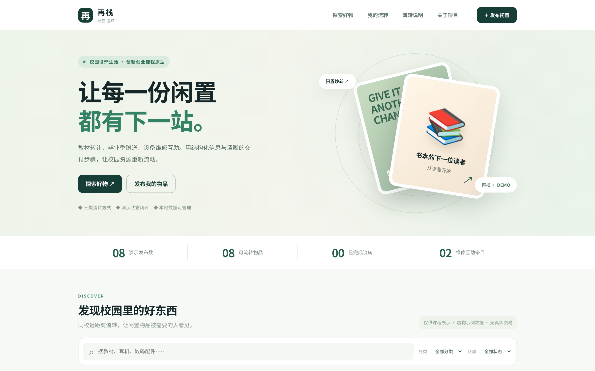
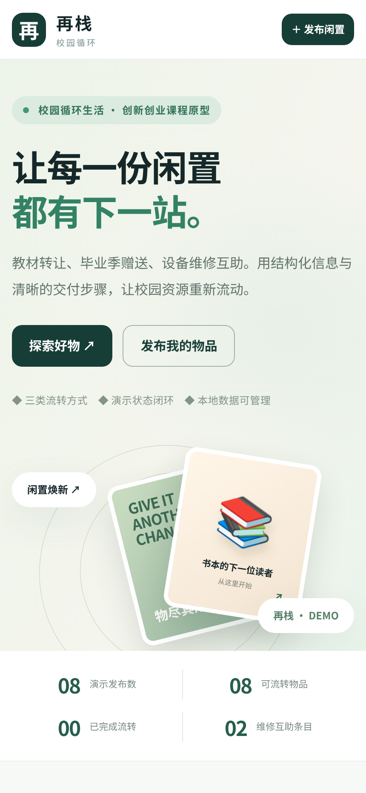

# Zaizhan 再栈

[简体中文](README.md) · English

A responsive front-end prototype for campus item reuse and repair assistance. Zaizhan brings together resale listings, free giveaways, and repair requests, demonstrating a complete flow from discovery and publishing to reservations, handover confirmation, and activity records.

Built with HTML, CSS, and vanilla JavaScript, it works on desktop and mobile screens. Eight fictional sample listings are included, and browser localStorage keeps demo activity on the current device. The project is intended for coursework presentations, product walkthroughs, and front-end learning.



## Features

- Search and filter by keyword, category, transfer mode, and status; sort results and show favorites only.
- View item descriptions, condition, price, and public handover locations.
- Publish, edit, unlist, and relist resale items, giveaways, and repair requests.
- Make or cancel reservations and simulate completion with a six-digit handover code.
- Review listings, reservations, favorites, completion statistics, and activity in a personal workspace.
- Keep local records across reloads, export them as JSON, and reset the demo.
- Use responsive layouts, form validation, and basic keyboard interactions.

## Quick start

Download or clone this repository, then open `index.html` in Chrome or Edge. No front-end dependencies need to be installed.

Alternatively, open `再栈.html`. This standalone file contains the styles and scripts and can be downloaded on its own for offline use.

For an optional local HTTP preview, run this command from the repository directory:

```sh
python -m http.server 8000
```

Then visit <http://localhost:8000>. Python is needed only for this optional preview method, not for opening the HTML files directly.

## Suggested walkthrough

Search for “计算机网络” → favorite an item and open its details → reserve it → try an incorrect code → enter the correct code → publish a listing → edit, unlist, and relist it → reload to check persistence → export JSON.

All three publishing modes are available. The reset button restores the initial sample data.

## Repository structure

```text
index.html          Entry point for the separate-file version
styles.css          Styling and responsive layouts
data.js             Eight fictional sample listings
app.js              Interactions, state, and local persistence
再栈.html           Self-contained HTML version
README.md           Chinese documentation
README.en.md        English documentation
LICENSE             MIT license
docs/images/        Desktop and mobile screenshots
```

## Data and scope

This is a front-end demonstration prototype. Default listings and users, as well as simulated completion records, do not represent real transactions. Publishing, reserving, and confirming an item affects only the current browser. Records are not shared across users, devices, browsers, or different site origins.

The prototype has no application backend, database, campus identity verification, or real payment integration. The six-digit code demonstrates a handover state transition; it is not identity verification or a transaction guarantee. The interface does not require real names, student IDs, phone numbers, or home addresses.

## Mobile preview



## License

This project is distributed under the [MIT License](LICENSE). Keep its copyright and permission notice when using, modifying, or distributing the software.
