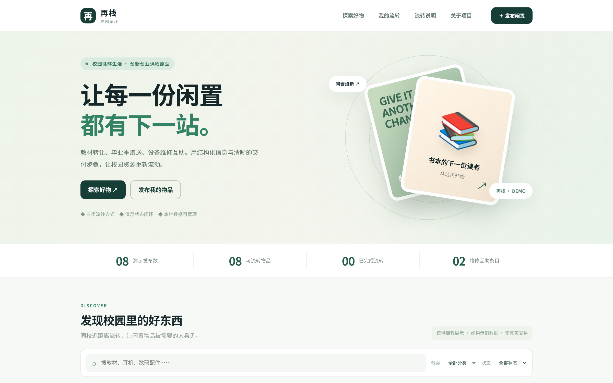
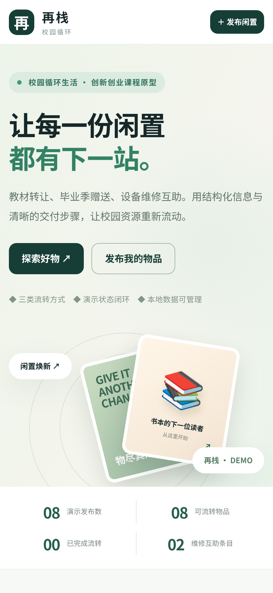

# 再栈 Zaizhan

简体中文 · [English](README.en.md)

校园闲置物品流转与维修互助前端原型。围绕有偿转让、免费赠送和维修互助，展示从物品发现、信息发布到预约、交接确认及记录管理的操作流程。

项目采用 HTML、CSS 和原生 JavaScript，适配电脑与手机。内置 8 条模拟物品信息，操作记录通过浏览器 localStorage 保存在本地，适用于课程汇报、产品流程展示与前端学习。



## 功能

- 按关键词、物品分类、流转方式和状态搜索筛选，支持排序与收藏筛选。
- 查看物品说明、成色、价格和公共交接地点。
- 发布、编辑、下架和重新上架转让、赠送或求修信息。
- 预约流转或响应维修互助，支持取消预约和六位演示口令确认。
- 在个人工作台查看发布、预约、收藏、完成率和操作记录。
- 刷新后保留本地记录，支持 JSON 导出及重置演示数据。
- 提供响应式布局、表单校验及基础键盘操作支持。

## 快速运行

下载或克隆仓库后，用 Chrome 或 Edge 打开 `index.html` 即可体验，无需安装前端依赖。

也可以打开 `再栈.html`：这是已内嵌样式与脚本的独立文件，可单独下载并离线运行。

如需通过本机静态服务器预览，在仓库目录执行：

```sh
python -m http.server 8000
```

然后访问 <http://localhost:8000>。Python 仅用于这一可选预览方式，双击打开网页无需 Python。

## 建议演示流程

搜索“计算机网络” → 收藏并查看详情 → 预约 → 输入错误口令 → 输入正确口令完成 → 发布物品 → 编辑与上下架 → 刷新验证保存 → 导出 JSON。

转让、赠送和求修三种发布方式均可体验。点击“重置演示数据”可恢复初始状态。

## 文件结构

```text
index.html          分文件版入口
styles.css          样式与响应式布局
data.js             8 条模拟物品信息
app.js              交互、状态管理与本地保存
再栈.html           可单独运行的完整网页
README.md           中文介绍
README.en.md        English documentation
LICENSE             MIT 许可证
docs/images/        电脑与手机界面截图
```

## 数据与项目范围

当前版本是前端演示原型，所有默认物品、用户和完成记录均为模拟数据。页面中的发布、预约和确认操作仅影响当前浏览器，不会向其他用户同步；不同设备、浏览器及访问地址之间的本地记录相互独立。

原型未接入业务后端、数据库、校园身份认证或真实支付。六位口令用于演示交接状态变化，不提供身份认证或交易担保。页面不要求填写真实姓名、学号、手机号或住址。

## 手机端预览



## 许可证

本项目采用 [MIT License](LICENSE)。使用、修改或分发时，请保留许可证中的版权及许可声明。
